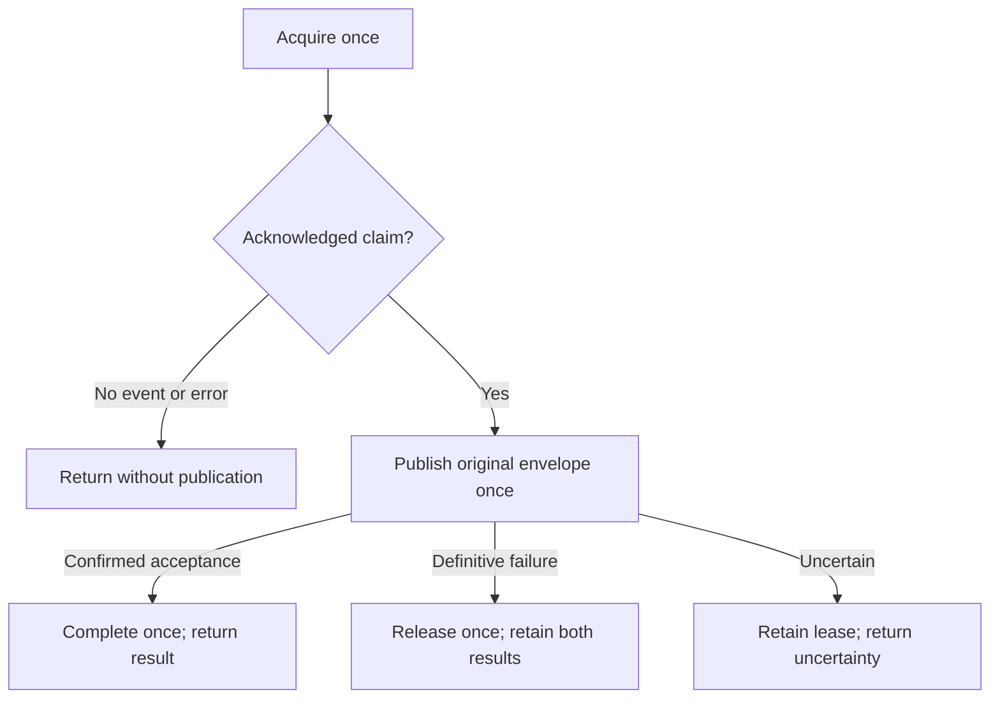

[Other language](../../pt-BR/architecture/milestone-2-4.md) | [README](../../../README.md)

# Milestone 2.4 — Delivery use-case orchestration

Implemented 2026-10-12 from clean `edb1f90`. [ADR 007](../adr/007-durable-delivery-ownership.md) and the [2.3 repository contracts](milestone-2-3.md) remain unchanged. The requested 2.3 handoff was absent from this checkout; source, Git history and dated validation were used instead. No applicable project AGENTS.md was found.

## Public API and sequencing

[application/delivery.rs](../../../src/application/delivery.rs) exposes `deliver_once(&repository, &publisher, AcquireRequest)`. The generic repository implements the three ownership ports; the publisher implements `EventPublisher + Sync`. Native futures remain Send with static dispatch. SQLx, Lapin, driver types, SQL and transactions remain in infrastructure. No forwarding service or workflow framework is added.

Each invocation calls acquisition once. `None` returns `NoEvent` with no later calls; this does not establish an empty backlog. An acquisition error returns `AcquisitionFailed` with the original error, request token and duration, but no invented claim. `CommitUncertain` may conceal a committed lease: do not publish or repeat the old token. Inspect durable state operationally or allow lease expiration and recover with a fresh request. There is no reconciliation query in this API.

Only acknowledged acquisition supplies a borrowed original `EventEnvelope` to publication once. ID, occurrence time, payload, schema version, aggregate and correlation/causation metadata remain intact. The repository has ended its transaction and returned its connection before this network wait. Observation snapshots from `OutboxReader` are never claims.

## Typed outcomes

| Outcome | Meaning |
| --- | --- |
| `NoEvent` | No event acquired by this call |
| `AcquisitionFailed { token, duration, error }` | No acknowledged claim; match `error.kind()` including CommitUncertain |
| `Published { claim, completion }` | Confirmed broker acceptance; `completion` independently describes durable transition |
| `PublicationFailed { claim, error, release }` | Original PublishError and independent cleanup outcome |

`DeliveryClaim` retains the acquired key (event ID/token), lease timestamps and acquisition count without retaining payloads. Derived Debug uses sanitized error formatting, omitting diagnostic source bodies; sources remain available for controlled, redacted diagnostics. No new Display implementation exposes event contents or credentials.

The transition result is the existing `Result<TransitionOutcome, PersistenceError>`: `Ok(Applied)` acknowledges the transition, `Ok(OwnershipLost)` records lost authority, other error kinds record infrastructure failure and `CommitUncertain` records unknown durability. This small model keeps publication and persistence facts separate without enumerating every combination. A future worker must inspect both, rather than treating every `Published` as success.

**Success means `Published` with `Ok(Applied)` completion.** It means broker acceptance plus acknowledged durable completion, not consumer processing, consumer business effects or exactly-once delivery. Failed, lost-authority or uncertain completion never triggers release, reacquisition or republishing in this invocation. Completion may already have committed; blind cleanup would obscure that fact. Later recovery can duplicate publication with the same original event ID.

## Publication failure policy

| PublishErrorKind | Contract evidence | Completion | Release |
| --- | --- | --- | --- |
| Unavailable | Before sending: admission, disconnected or retired publisher | Never | Once |
| Serialization | JSON encoding failed before sending | Never | Once |
| Unroutable | Definitive mandatory return with acknowledgement | Never | Once |
| Rejected | Definitive negative broker confirmation | Never | Once |
| Uncertain | Sending began; acceptance may have occurred | Never | Retain lease |

This is a project policy based on the [publisher implementation](../../../src/infrastructure/rabbitmq.rs), not a universal treatment of transport errors. Publication error classification and diagnostic source are preserved even if release fails. `ReleaseOutcome::Attempted` independently exposes Applied, OwnershipLost, ordinary error or CommitUncertain. It never retries. The port preserves attempt_count, available_at and last_error, with no new diagnostic parameters or backoff. Immediate release can make a due event immediately eligible, including repeatedly failing events; scheduling and poison-event policy are future work.

`ReleaseOutcome::LeaseRetained` accompanies Uncertain. Retention delays recovery; it does not reconcile acceptance or prevent duplicates. The original `PublishErrorKind::Uncertain` also tells composition that the RabbitMQ adapter retires its channel. This use case does not reconnect or replace publishers; cancellation after send can retire that channel without an observable typed outcome.

## Lease and cancellation boundaries

There is no best-effort application wall-clock expiration check. PostgreSQL evaluates authority after the row lock; response latency can already consume the entire lease. Expiration during send or completion is possible. Tokens protect database transitions, not external sends by stale workers. No renewal, fencing or new ownership query is introduced. Attempts count committed acquisitions, not actual sends.

| Cancellation boundary | Possible effect and recovery |
| --- | --- |
| During acquisition | Commit may occur without a returned claim; recover durable state/lease expiration, never reuse token |
| After acquisition, before publication | Abandoned acknowledged lease; no automatic cleanup; expiration permits recovery |
| During publication | Acceptance may occur without observed confirmation; no subsequent completion/release; RabbitMQ may retire channel |
| After acceptance, before completion | Broker accepted while row can remain pending; recovery may publish again |
| During completion commit | Processed may already be durable although no outcome returns |
| During release commit | Ownership may already be cleared although no outcome returns |

Dropping a future can suppress its outcome. It does not establish rollback, nonacceptance or an observable cancellation error. No detached cleanup task, asynchronous Drop or implicit supervisor exists. Fake cancellation tests prove only absence of subsequent fake calls, not actual PostgreSQL rollback or RabbitMQ nonacceptance.

## Evidence and next scope

[Use-case tests](../../../tests/delivery_use_case.rs) cover all publication categories and transition results, exact envelope equality, original error/source preservation, event/token context, single-call sequencing, confirmation gating, cancellation at four awaited boundaries and Send/static-dispatch behavior. The expired fixture intentionally shows that the application does not substitute its clock for database authority. See [dated validation](../testing/validation-results.md#milestone-24--2026-10-12) and 2.4 handoff (absent in the 2.5 checkout).

Infrastructure code and schema are unchanged, so unrelated opt-in real PostgreSQL/RabbitMQ regressions were not rerun. There is no polling worker, Supervisor registration, reconnection, retry/backoff/jitter, quarantine/DLQ, producer endpoint or consumer idempotency. No performance, end-to-end at-least-once or exactly-once claim is made. **2.5** composes and operates the polling worker, publisher lifecycle/reconnection and Supervisor integration. **2.6** performs end-to-end crash/recovery failure experiments.
