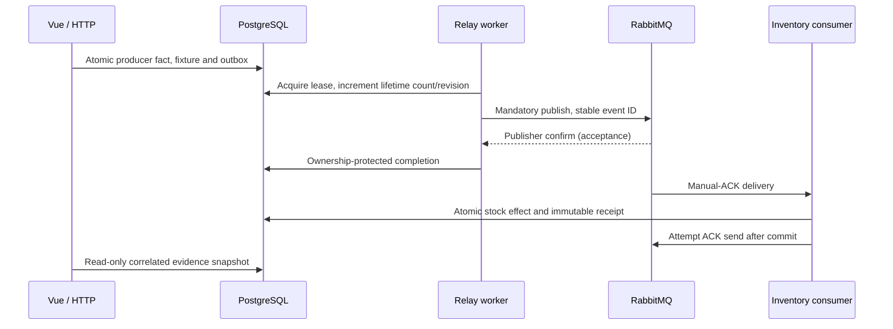

# Final local implementation: one event, five evidence boundaries

Static review: 2026-10-18 at `6e5e64fbffea1eb3ec50b828648f3fa9e708cf6c`. The accepted scope is a bounded local portfolio demonstration, with real producer, relay, consumer and Vue inspection. No runtime was started or revalidated in this review. [Installation and supported addresses](../../../README.md), [application operations](../operations/application-scenarios.md) and [final acceptance](../operations/final-audit.md) remain separate from historical milestone plans.

## Start with one durable intent

The supported workflow is `python3 scripts/start-local.py` from the repository root after configuring `.env.example` locally. One main `compose.yaml` owns app, frontend, PostgreSQL and RabbitMQ; `compose.demo.yaml` is a historical dedicated-stack artifact. Defaults: frontend localhost:5173, HTTP localhost:8080, PostgreSQL localhost:5433 and management localhost:15672. HTTP, relay and consumer are separate supervised binaries. `/health` is HTTP liveness; role-specific `/ready` and `/metrics` remain internal on 9100/9101/9102.

`application/demo.rs` validates a fixed intent. `infrastructure/postgres/demo.rs` uses one SQL transaction for initial stock 10, `demo.runs`, `demo.goods_receipts` and the canonical `relay.outbox_events` envelope with quantity 5. A durable goods receipt is the producer business fact, not consumer processing. Repeating an identical request UUID reuses its intent; changed content conflicts. A commit response or subsequent evidence read can fail after the transaction committed. Inspection with the same identity resolves what is observable; generating a new identity is new work.

The diagram expresses responsibilities, not a guaranteed global observation order. Consumer commit can become visible before relay completion. The five boundaries are broker acceptance, outbox completion, consumer commit, local ACK send and broker receipt of that ACK. A successful ACK send is not evidence that the broker received it. SQL and AMQP do not form one transaction; no exactly-once transport is promised.

## Publication authority, retry and replay

`postgres/ownership.rs` selects eligible work using a short transaction and `FOR UPDATE SKIP LOCKED`. Availability, pending status, lease expiration, cycle budget and representable counters/revision constrain acquisition. Every committed acquisition increments lifetime `attempt_count`, including a crash before send; a retry cycle uses a baseline rather than resetting that history. A fresh ownership token plus state revision and database-authoritative lease checks protect transitions. Stale snapshots are not authority, and an expired worker can still publish externally: a SQL token does not fence RabbitMQ.

`application/delivery.rs` separates acquisition, publication and transition outcomes. Mandatory routing/returns and publisher confirms distinguish known rejection/unroutable results from uncertainty. Missing confirmation does not prove nonacceptance. A lost completion COMMIT acknowledgement may hide durable processed state. Connection replacement restores a usable publisher; it does not reconcile an earlier send.

Durable retry stores `available_at` and diagnostic state; exponential capped equal jitter has a one-second initial ceiling and five-minute cap. Worker pacing is a different mechanism. Acquisition budget exhaustion or unrecoverable input preserves terminal SQL `dead_letter` instead of deleting the event. Bounded discovery returns inspection candidates; mutation rereads and obtains fresh authority rather than trusting a stale candidate. Authorized replay requires the operator contract, stable request identity, expected state/revision and audit record. It starts another cycle without changing the canonical event identity or erasing lifetime history. Replayed messages may be duplicates of an already committed consumer effect. The demo token does not authorize operator replay; empty `REPLAY_OPERATORS` disables that API.

## Consumer transaction and quarantine

`postgres/consumer.rs` first inserts identity `(consumer_name,event_id)` with conflict handling, then locks/updates stock and completes the receipt in the same READ COMMITTED transaction. The unique key serializes identical identities. A losing insert reads the committed winner through a fresh statement snapshot and compares validated immutable model content, not just an ID or digest. Stored versioned BYTEA preserves envelope representation that JSONB/timestamp normalization could alter. Deferred completeness constraints prevent partial receipts; guards protect completed receipts against ordinary mutation/removal. Database owners can bypass application safeguards, so this is not tamper-proof evidence.

Normal delivery commits stock 10 → 15 and one receipt. Equal duplicate content yields Duplicate with stock still 15; the same ID with conflicting content must not apply another effect. ACK is attempted only after durable processing or confirmed preservation of rejected input. Invalid/unsupported/conflicting input uses application-managed confirmed quarantine; if preservation fails or exact supported preservation is impossible, retain the source without ACK. SQL `dead_letter` is relay terminal state, distinct from RabbitMQ quarantine.

Default AMQP topology is durable direct `relay.events`, routing key `event`, source queue `relay.local`, in vhost `relay`. Quarantine uses `relay.quarantine` → `relay.quarantine.inventory` with key `inventory`. Duplicate actions use queue/routing key `relay.demo.<action UUID>` and bounded temporary consumers; retained observations correlate run/event/action rather than relying on aggregate broker graphs. Queues and receipts are not disposable repair targets.

## What the UI actually does

| Classification | Supported behavior | Evidence limit |
| --- | --- | --- |
| Real | Normal 10 → 15 delivery | Producer, outbox, receipt and stock are separate facts |
| Real | Duplicate and concurrent duplicate | Identical original envelope, correlated Duplicate classification, one effect, stock 15 |
| Real | One run-scoped before-send rejection then retry | Durable controlled fault; not a broker outage or broker NACK |
| Illustrative | Crash, worker race, lost confirmation/ACK playback | Educational sequence, not infrastructure fault injection |
| Integration tests only | Actual kill/reconnect, ambiguous COMMIT/confirmation, lease races and consumer failure boundaries | Isolated schedules in recorded tests, not UI controls or universal guarantees |

Vue uses HTTP through its configured proxy; this is not WebSocket broker delivery. `/demo/runs` POST accepts producer intent; `/demo/actions` POST accepts bounded duplicate work. GET `/demo/runs/{request_id}`, `/demo/history` and `/demo/config` expose evidence/configuration. GET `/demo/runs` selects successful retained runs. Bearer token checks, permitted origin, `x-demo-client: demo61`, bounded body/concurrency/rate and deadlines restrict this local interface. Token stays in browser memory; session storage keeps identifiers only. Application credentials are not TLS or envelope encryption.

History includes pending/terminal/unknown runs, stable pagination and `observed_at`. Snapshots become stale after 15 seconds; refresh failure does not erase the earlier observation. Sequential polling lasts at most 60 seconds with a nine-second browser request timeout. Closing/reloading stops observation, not committed work. GET inspection never republishes; an unknown action is not silently resent. Observation caps make counts lower bounds, and a SQL snapshot cannot rule out later commit.

## Follow the records without mutation

Use the displayed IDs and read-only SQL in the [application guide](../operations/application-scenarios.md). Schema responsibilities:

- `demo`: producer facts/runs, actions, publication/classification observations and controlled faults.
- `relay`: canonical outbox, ownership/retry state and authorized replay audit.
- `consumer`: stock and deduplication/effect receipts.
- `public._sqlx_migrations`: applied migration versions/checksums, not business delivery proof.

For example, in a read-only transaction select the exact event's outbox status, attempt count and revision; its consumer receipt; stock by warehouse/SKU; then its run/action observations. Never interpret a processed outbox alone as 15 units or absence of a receipt as proof of rollback. Preserve receipt identity as long as redelivery is possible. Main storage consolidation verifies history and supports protected backup/disposable restore before forward changes; direct Compose startup is not the supported retained-storage migration procedure. No automatic retention, generalized unknown-action repair or broker disaster recovery is delivered.

## Study and evidence path

1. Start at `application/demo.rs` and `postgres/demo.rs`; match request/run/event identity and the producer transaction to `backend/tests/demo_runs.rs`.
2. Follow `worker.rs`/`delivery.rs`, ownership/retry/discovery/replay ports and PostgreSQL adapters. Compare `delivery_ownership`, `postgres_retry`, `postgres_discovery` and `postgres_replay` tests with ADRs 007–009.
3. Trace `rabbitmq.rs` confirms and topology; distinguish accepted publication from `processed_at`.
4. Trace `application/consume.rs`, `postgres/consumer.rs` and RabbitMQ consumer/quarantine. Read `postgres_consumer`, `consumer_runtime` and `integrated_recovery` tests with ADR 010.
5. Follow `demo_delivery.rs`, action evidence and `frontend/src/composables/useDemoRun.ts`; compare `frontend/tests/real-scenarios.spec.ts` and live failure tests. Return to persisted facts before interpreting the UI (ADRs 011–012).

The [2026-10-17 manifest](../../audit/2026-10-17/manifest.json) attributes final local acceptance to base `18893c865eba506e7d4a2124864920d82ce6237d`: 243 unique Rust passed entries (241 substantive, two helpers), 27 real-application browser checks, a separate 24-check clean-install run and nine migrations. These are recorded results, not tests executed now or proof at the current revision. Later commits changed startup/token/test tooling; remote CI remains unverified. On 2026-10-18 the owner confirmed the former audit PDF no longer exists and may be disregarded; its manifest hash remains provenance only. No replacement PDF was generated.

**Interview practice:** explain how a confirm-before-completion crash permits republication, why consumer identity prevents a second local stock effect, and why neither proves broker receipt of ACK. Compare a single database transaction (simpler local atomicity) with AMQP (independent durable transport) and an external payment/email effect (cannot join this consumer transaction). Then defend lease expiry, lifetime acquisition accounting, unknown outcomes, quarantining and bounded evidence. TLS/HA, larger scale, external side-effect protocols and protected retention are hypothetical future work, not unfinished promises inside the accepted local scope.
