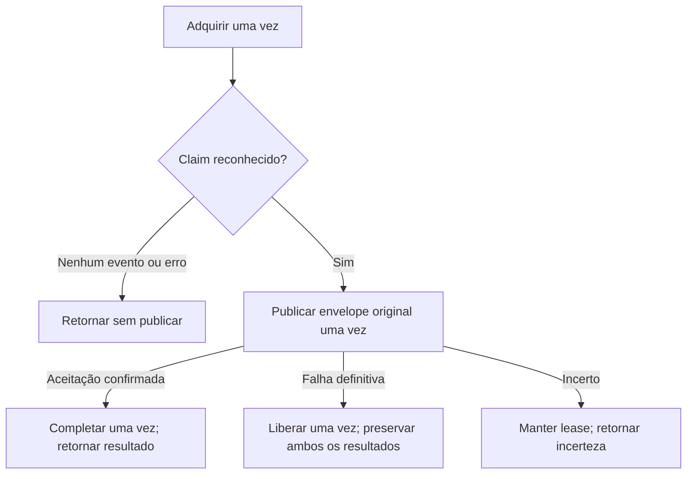

[English](../../en/architecture/milestone-2-4.md) | [README](../../../README.pt-BR.md)

# Marco 2.4 — Orquestração do caso de uso de entrega

Implementado em 2026-10-12 a partir do checkout limpo `edb1f90`. A [ADR 007](../adr/007-durable-delivery-ownership.md) e os [contratos de 2.3](milestone-2-3.md) permanecem intactos. O handoff 2.3 solicitado não existe neste checkout; código, histórico Git e validação datada foram usados como base. Nenhum AGENTS.md aplicável aos projetos foi encontrado.

## API pública e sequência

[application/delivery.rs](../../../backend/src/application/delivery.rs) expõe `deliver_once(&repository, &publisher, AcquireRequest)`. O repositório genérico implementa os três ports de ownership; o publisher implementa `EventPublisher + Sync`. Futures nativas continuam Send e usam despacho estático. SQLx, Lapin, tipos de drivers, SQL e transações ficam na infraestrutura. Não há serviço de encaminhamento nem framework de workflows.

Cada chamada adquire uma vez. `None` retorna `NoEvent` sem operações posteriores; isso não comprova backlog vazio. Erro retorna `AcquisitionFailed` com erro original, token e duração da requisição, sem inventar uma posse. `CommitUncertain` pode ocultar lease já persistido: não publicar nem repetir o token antigo. Inspecionar estado durável operacionalmente ou aguardar expiração e recuperar com nova requisição. A API não adiciona consulta de reconciliação.

Somente aquisição com commit reconhecido fornece o `EventEnvelope` original emprestado ao publisher, uma vez. ID, horário de ocorrência, payload, versão, agregado e metadados de correlação/causalidade são preservados. A operação do repositório encerrou transação e devolveu conexão antes da espera de rede. Snapshots do `OutboxReader` nunca são claims.

## Resultados tipados

| Resultado | Significado |
| --- | --- |
| `NoEvent` | Esta chamada não adquiriu evento |
| `AcquisitionFailed { token, duration, error }` | Sem claim reconhecido; consultar `error.kind()`, inclusive CommitUncertain |
| `Published { claim, completion }` | Aceitação confirmada pelo broker; completion descreve transição durável separadamente |
| `PublicationFailed { claim, error, release }` | PublishError original e resultado independente de cleanup |

`DeliveryClaim` conserva chave (ID/token), timestamps do lease e contador de aquisições, sem payload. Debug usa formatação sanitizada dos erros, omitindo corpos das fontes diagnósticas; fontes continuam disponíveis para diagnóstico com redação. Nenhuma implementação nova de Display expõe conteúdo ou credenciais.

A transição usa o contrato existente `Result<TransitionOutcome, PersistenceError>`: `Ok(Applied)` reconhece aplicação, `Ok(OwnershipLost)` indica perda de autoridade, demais categorias indicam falha de infraestrutura e `CommitUncertain` indica durabilidade desconhecida. Esse modelo mantém publicação e persistência separadas sem listar todas as combinações. Um worker deve analisar ambos, sem tratar todo `Published` como sucesso.

**Sucesso é `Published` com completion `Ok(Applied)`.** Significa aceitação do broker e conclusão durável reconhecida, não processamento do consumidor, efeito de negócio ou entrega exatamente uma vez. Completion com falha, perda de autoridade ou incerteza nunca dispara release, nova aquisição ou publicação nesta chamada. Completion pode já ter persistido; cleanup cego ocultaria esse fato. Recuperação posterior pode duplicar publicação com o ID original.

## Política de falha de publicação

| PublishErrorKind | Evidência do contrato | Completion | Release |
| --- | --- | --- | --- |
| Unavailable | Antes do envio: admissão, publisher desconectado ou aposentado | Nunca | Uma vez |
| Serialization | Codificação JSON falhou antes do envio | Nunca | Uma vez |
| Unroutable | Retorno mandatory definitivo com confirmação | Nunca | Uma vez |
| Rejected | Confirmação negativa definitiva do broker | Nunca | Uma vez |
| Uncertain | Envio iniciado; aceitação pode ter ocorrido | Nunca | Manter lease |

É uma escolha deste projeto baseada no [publisher](../../../backend/src/infrastructure/rabbitmq.rs), não uma regra universal para erros de transporte. Categoria e fonte da falha original permanecem mesmo se release falhar. `ReleaseOutcome::Attempted` expõe separadamente Applied, OwnershipLost, erro comum ou CommitUncertain. Não repete. O port preserva attempt_count, available_at e last_error, sem parâmetros diagnósticos novos ou backoff. Release imediato pode tornar evento vencido imediatamente elegível, inclusive falhas repetidas; agendamento e política de eventos problemáticos ficam para depois.

`ReleaseOutcome::LeaseRetained` acompanha Uncertain. Retenção apenas adia recuperação; não reconcilia aceitação nem impede duplicatas. A categoria original `PublishErrorKind::Uncertain` informa à composição que o adaptador RabbitMQ aposenta o canal. O caso de uso não reconecta nem substitui publisher; cancelamento após envio pode aposentar o canal sem resultado tipado observável.

## Lease e cancelamento

Não há checagem de expiração pelo relógio da aplicação. PostgreSQL avalia autoridade depois do lock; latência da resposta pode consumir todo o lease. Expiração durante publicação ou completion é possível. Tokens protegem transições no banco, não envios externos de workers obsoletos. Não há renovação, fencing ou nova consulta de posse. Attempts contam aquisições persistidas, não envios.

| Fronteira de cancelamento | Efeito possível e recuperação |
| --- | --- |
| Durante aquisição | Commit pode ocorrer sem claim retornado; recuperar estado/expiração, nunca reutilizar token |
| Após aquisição, antes de publicar | Lease reconhecido abandonado; sem cleanup automático; expiração permite recuperação |
| Durante publicação | Aceitação pode ocorrer sem confirmação observada; sem completion/release posterior; RabbitMQ pode aposentar canal |
| Após aceitação, antes de completion | Broker aceitou, mas linha pode continuar pending; recuperação pode publicar novamente |
| Durante commit de completion | Processed pode estar durável mesmo sem resultado retornado |
| Durante commit de release | Posse pode estar removida mesmo sem resultado retornado |

Descartar future pode suprimir seu resultado. Não comprova rollback, não aceitação ou erro tipado observável de cancelamento. Não há tarefa destacada de cleanup, Drop assíncrono ou supervisor implícito. Testes de cancelamento com fakes demonstram apenas ausência de chamadas seguintes, não rollback PostgreSQL ou não aceitação RabbitMQ.

## Evidência e próximo escopo

[Testes do caso de uso](../../../backend/tests/delivery_use_case.rs) cobrem todas as categorias de publicação e resultados de transição, igualdade completa do envelope, preservação de erro/fonte, contexto ID/token, sequência de chamadas únicas, espera pela confirmação, cancelamento em quatro fronteiras aguardadas e Send/despacho estático. O fixture expirado demonstra que a aplicação não substitui autoridade do banco pelo seu relógio. Consulte [validação datada](../testing/validation-results.md#marco-24--2026-10-12) e handoff 2.4 (ausente no checkout 2.5).

Infraestrutura e schema não mudaram; suítes reais opt-in de PostgreSQL/RabbitMQ não foram repetidas sem motivo. Não há polling, registro de worker no Supervisor, reconexão, retry/backoff/jitter, quarentena/DLQ, endpoint produtor ou idempotência do consumidor. Não há alegação de desempenho, entrega ponta a ponta pelo menos uma vez ou exatamente uma vez. **2.5** compõe e opera worker de polling, lifecycle/reconexão do publisher e integração Supervisor. **2.6** executa experimentos ponta a ponta de falha, crash e recuperação.

## Marco 3.3 — integração atual

Integração de entrega/worker implementada; seções anteriores mantêm seu escopo histórico datado. [Contratos atuais, jitter, matriz contextual, manutenção e cancelamento](milestone-3-3.md). Scanning geral fica em 3.4, replay auditado em 3.5 e aceitação completa em 3.6; rollout compartilhado permanece pendente.
