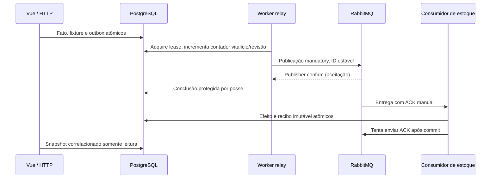

# Implementação local final: um evento, cinco fronteiras de evidência

Revisão estática: 2026-10-18 em `6e5e64fbffea1eb3ec50b828648f3fa9e708cf6c`. O escopo aceito é demonstração local limitada de portfólio, com produtor, relay, consumidor e inspeção Vue reais. Nenhum runtime foi iniciado ou revalidado nesta revisão. [Instalação e endereços suportados](../../../README.pt-BR.md), [operação](../operations/application-scenarios.md) e [aceite final](../operations/final-audit.md) são separados dos planos históricos.

## Comece por uma intenção durável

O fluxo suportado é `python3 scripts/start-local.py` na raiz após configurar `.env.example` localmente. Um único `compose.yaml` principal controla app, frontend, PostgreSQL e RabbitMQ; `compose.demo.yaml` é artefato histórico da stack dedicada. Padrões: frontend localhost:5173, HTTP localhost:8080, PostgreSQL localhost:5433 e management localhost:15672. HTTP, relay e consumidor são binários supervisionados separados. `/health` mede liveness HTTP; `/ready` e `/metrics` de cada papel ficam internos em 9100/9101/9102.

`application/demo.rs` valida intenção fixa. `infrastructure/postgres/demo.rs` usa uma transação SQL para estoque inicial 10, `demo.runs`, `demo.goods_receipts` e envelope canônico em `relay.outbox_events` com quantidade 5. O recebimento de mercadoria durável é fato do produtor, não processamento do consumidor. Repetir UUID idêntico reutiliza a intenção; mudar conteúdo gera conflito. A resposta de COMMIT ou leitura seguinte pode falhar após commit. Inspecionar a mesma identidade resolve o que for observável; gerar nova identidade é trabalho novo.

O diagrama expressa responsabilidades, não ordem global garantida de observação. Commit do consumidor pode aparecer antes da conclusão do relay. As cinco fronteiras são aceitação do broker, conclusão da outbox, commit do consumidor, envio local de ACK e recebimento desse ACK pelo broker. Sucesso no envio não prova recebimento. SQL e AMQP não formam transação única; não há promessa de transporte exatamente uma vez.

## Autoridade, retry e replay

`postgres/ownership.rs` seleciona trabalho elegível em transação curta com `FOR UPDATE SKIP LOCKED`. Disponibilidade, estado pending, expiração, orçamento do ciclo e limites de contador/revisão restringem aquisição. Cada aquisição confirmada incrementa `attempt_count` vitalício, inclusive crash antes do envio; um ciclo usa baseline sem zerar o histórico. Token novo, revisão e lease conferido pelo banco protegem transições. Snapshots antigos não concedem autoridade; worker expirado ainda pode publicar externamente: token SQL não faz fencing do RabbitMQ.

`application/delivery.rs` separa aquisição, publicação e transição. Mandatory/returns e publisher confirms distinguem rejeição conhecida/unroutable de incerteza. Falta de confirmação não prova não aceitação. Perda da resposta de COMMIT pode ocultar estado processed. Trocar conexão restaura um publisher utilizável; não reconcilia envio anterior.

Retry durável grava `available_at` e diagnóstico; equal jitter exponencial limitado tem teto inicial de um segundo e máximo de cinco minutos. Pausa do worker é outro mecanismo. Esgotar orçamento ou receber entrada irrecuperável preserva terminal SQL `dead_letter`, sem apagar evento. Descoberta limitada fornece candidatos; mutação relê e obtém autoridade nova, sem confiar em candidato antigo. Replay autorizado exige contrato de operador, identidade estável de requisição, estado/revisão esperados e auditoria. Inicia outro ciclo sem mudar identidade canônica ou apagar contagem vitalícia. Replay pode duplicar efeito já confirmado no consumidor. Token demo não autoriza replay operacional; `REPLAY_OPERATORS` vazio desabilita essa API.

## Transação do consumidor e quarentena

`postgres/consumer.rs` insere primeiro `(consumer_name,event_id)` com tratamento de conflito, depois bloqueia/atualiza estoque e completa recibo na mesma transação READ COMMITTED. A chave única serializa identidades iguais. Quem perde a inserção lê o vencedor confirmado em novo snapshot de comando e compara conteúdo imutável do modelo validado, não apenas ID/digest. BYTEA versionado preserva representação que normalização JSONB/timestamp poderia alterar. Constraints diferidas impedem recibos incompletos; guards protegem recibos concluídos contra alteração/remoção comum. Proprietários do banco podem contornar proteção; não é evidência inviolável.

Entrega normal confirma estoque 10 → 15 e um recibo. Conteúdo duplicado igual gera Duplicate e mantém 15; mesmo ID com conteúdo conflitante não deve aplicar novo efeito. ACK só é tentado após processamento durável ou preservação confirmada da entrada rejeitada. Entrada inválida/não suportada/conflitante usa quarentena confirmada gerida pela aplicação; se preservação falha ou ultrapassa o suporte exato, mantém a origem sem ACK. SQL `dead_letter` é terminal do relay, diferente da quarentena RabbitMQ.

Topologia AMQP padrão: exchange direct durável `relay.events`, chave `event`, fila `relay.local`, vhost `relay`. Quarentena: `relay.quarantine` → `relay.quarantine.inventory`, chave `inventory`. Ações duplicadas usam fila/chave `relay.demo.<UUID da ação>` e consumidores temporários limitados; observações correlacionam execução/evento/ação em vez de depender de gráficos agregados. Filas e recibos não são alvos descartáveis de reparo.

## O que a UI executa

| Classificação | Comportamento suportado | Limite da evidência |
| --- | --- | --- |
| Real | Entrega normal 10 → 15 | Produtor, outbox, recibo e estoque são fatos separados |
| Real | Duplicata e duplicata concorrente | Envelope original, Duplicate correlacionado, um efeito e estoque 15 |
| Real | Uma rejeição antes do envio e retry por execução | Falha controlada durável; não é indisponibilidade nem NACK do broker |
| Ilustrativo | Crash, corrida e perda de confirmação/ACK | Sequência educacional, sem injeção de falha de infraestrutura |
| Só testes de integração | Kill/reconexão reais, COMMIT/confirmação ambíguos, corridas de lease e falhas do consumidor | Agendamentos isolados registrados, não controles da UI ou garantias universais |

Vue usa HTTP pelo proxy configurado; não é entrega de broker por WebSocket. POST `/demo/runs` aceita intenção; POST `/demo/actions` aceita duplicação limitada. GET `/demo/runs/{request_id}`, `/demo/history` e `/demo/config` expõem evidência/configuração. GET `/demo/runs` seleciona execuções bem-sucedidas. Bearer, origem permitida, `x-demo-client: demo61`, corpo/concorrência/taxa e prazos limitam a interface local. Token permanece na memória do navegador; session storage guarda só identificadores. Credenciais não são TLS ou criptografia do envelope.

Histórico inclui execuções pending/terminal/unknown, paginação estável e `observed_at`. Snapshot fica stale após 15 segundos; falha de refresh não apaga a observação anterior. Polling sequencial dura até 60 segundos com timeout de nove segundos no navegador. Fechar/recarregar interrompe observação, não trabalho confirmado. GET nunca republica; ação desconhecida não é reenviada silenciosamente. Contagens são limites inferiores por causa dos caps; snapshot SQL não exclui commit posterior.

## Acompanhe registros sem mutação

Use IDs exibidos e SQL somente leitura do [guia operacional](../operations/application-scenarios.md). Responsabilidades:

- `demo`: fatos/execuções do produtor, ações, observações de publicação/classificação e falhas controladas.
- `relay`: outbox canônica, posse/retry e auditoria de replay autorizado.
- `consumer`: estoque e recibos de deduplicação/efeito.
- `public._sqlx_migrations`: versões/checksums aplicados, não prova de entrega de negócio.

Em transação somente leitura, selecione status, contador e revisão do evento, seu recibo, estoque por warehouse/SKU e observações da execução/ação. Outbox processed isolada não prova 15 unidades; ausência de recibo não prova rollback. Preserve identidade enquanto houver possibilidade de reentrega. Consolidação verifica histórico e faz backup protegido/restauração descartável antes de mudanças forward; Compose direto não é o procedimento suportado de migration em armazenamento retido. Não há retenção automática, reparo geral de ações desconhecidas ou recuperação de desastre do broker.

## Roteiro e evidências

1. Comece em `application/demo.rs` e `postgres/demo.rs`; relacione identidades e transação com `backend/tests/demo_runs.rs`.
2. Siga `worker.rs`/`delivery.rs`, portas de posse/retry/descoberta/replay e adaptadores PostgreSQL. Compare testes `delivery_ownership`, `postgres_retry`, `postgres_discovery`, `postgres_replay` e ADRs 007–009.
3. Acompanhe confirms/topologia em `rabbitmq.rs`; separe publicação aceita de `processed_at`.
4. Siga `application/consume.rs`, `postgres/consumer.rs` e consumidor/quarentena RabbitMQ. Leia testes `postgres_consumer`, `consumer_runtime`, `integrated_recovery` e ADR 010.
5. Siga `demo_delivery.rs`, evidência da ação e `frontend/src/composables/useDemoRun.ts`; compare `frontend/tests/real-scenarios.spec.ts` e testes live de falha. Retorne aos fatos persistidos antes de interpretar a UI (ADRs 011–012).

O [manifesto de 2026-10-17](../../audit/2026-10-17/manifest.json) atribui aceite local à base `18893c865eba506e7d4a2124864920d82ce6237d`: 243 entradas Rust únicas aprovadas (241 substantivas, dois helpers), 27 verificações browser da aplicação real, outra instalação limpa com 24 e nove migrations. São resultados registrados, não execução atual nem prova na revisão presente. Commits posteriores alteraram startup/token/ferramentas de testes; CI remoto segue não verificado. Em 2026-10-18 o proprietário confirmou que o antigo PDF não existe mais e pode ser desconsiderado; seu hash no manifesto permanece apenas proveniência. Não foi gerado substituto.

**Prática de entrevista:** explique por que crash após confirm e antes de conclusão permite republicação, por que identidade no consumidor impede segundo efeito local e por que nenhum deles prova recebimento do ACK pelo broker. Compare transação única (atomicidade local simples), AMQP (transporte durável independente) e pagamento/email externo (fora desta transação). Defenda expiração, contagem vitalícia, resultados desconhecidos, quarentena e evidência limitada. TLS/HA, maior escala, protocolos de efeito externo e retenção protegida são possibilidades futuras, não promessas pendentes do escopo local aceito.
